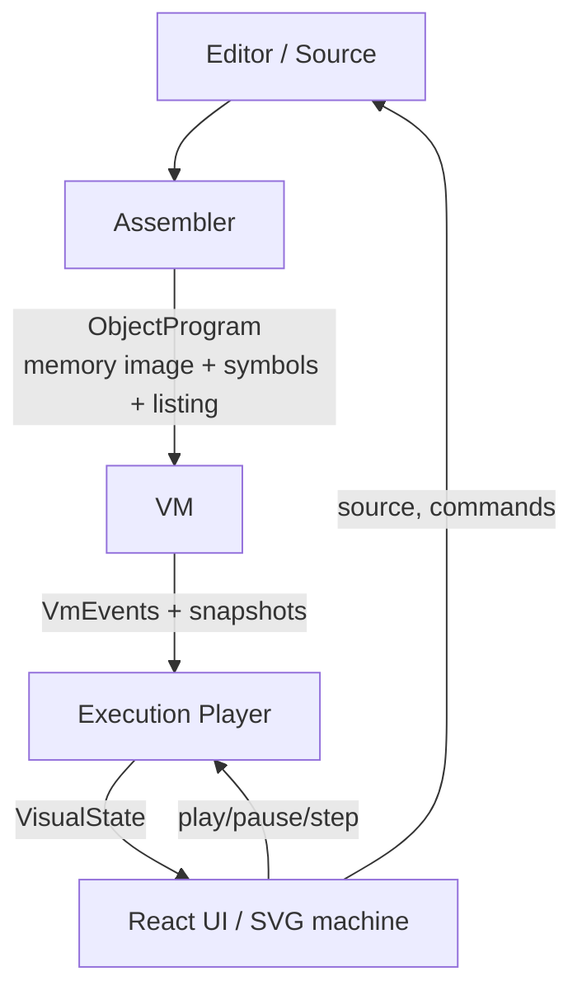
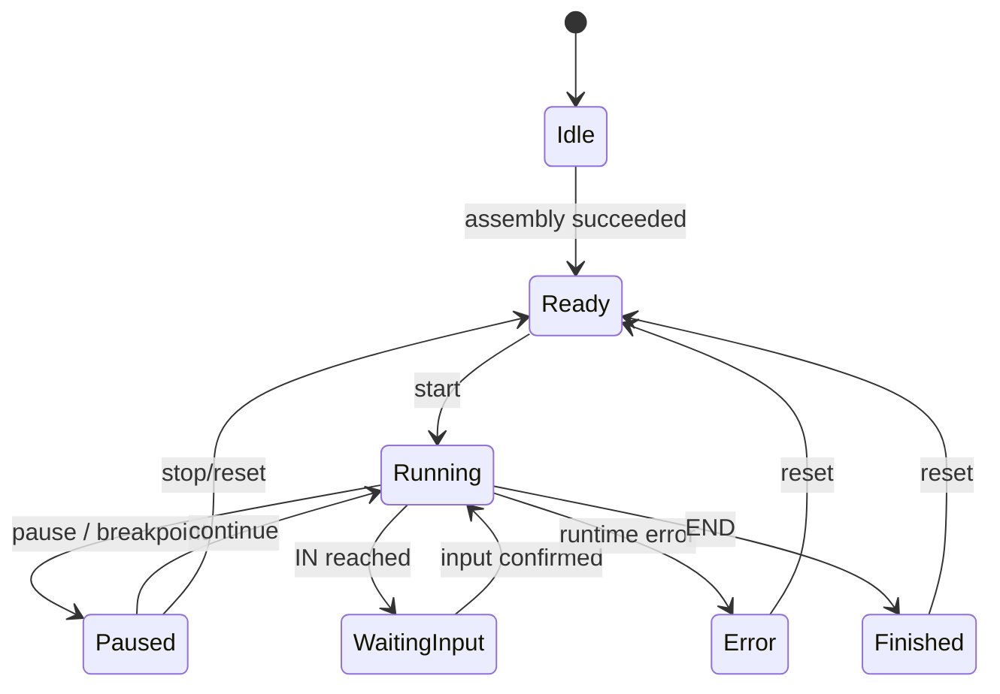

# MOPS as a Web Application: Analysis and Architecture Proposal

**Subject:** The original MOPS model computer with its pseudo-assembler and von Neumann machine  
**Goal:** A web application focused on clear visualization and animation.

---

## 1. Executive Summary

**React + TypeScript + SVG is a strong fit for this project.**

The key finding from the analysis is that graphics are **not** the hard part.
The original von Neumann machine diagram consists of only **316 canvas primitives**:

| Element type           | Count |
| ---------------------- | ----: |
| Text                   |   183 |
| Rectangles             |    90 |
| Lines (bus paths)      |    42 |
| Polygon (ALU triangle) |     1 |

That is four functional units, 72 memory cells, about 20 named signal paths, and a
handful of registers. There are **no bitmap graphics in the machine diagram**, no
particles, no 3D scene, and no continuous physics. In the original, animation is
only a sequence of **color changes** (fill and border) on individual elements.

SVG is therefore ideal:

- 316 elements are negligible for a browser.
- SVG scales without loss and stays sharp on projectors and tablets.
- Text, borders, and buses can be styled and animated directly with CSS.
- React can bind each element declaratively to the machine state.
- Accessibility, tooltips, hit targets, and theming are straightforward.

The real complexity lies elsewhere:

1. **Assembler:** source text to a real object program (memory image, symbols, listing).
2. **VM:** execution of the object program only, never the source text.
3. **Time and state:** microcycles, pause, stepping, speed, and input.
4. **State-to-visualization coupling:** which element is active when, and how that
   remains consistent during pause, backward stepping, and fast execution.

The architecture should therefore have clearly separated layers:

```text
Assembler  ->  Object Program  ->  VM  ->  Execution Player  ->  React/SVG UI
Source         Memory image        CPU     Time, pause, history    Presentation
```

The assembler knows nothing about runtime. The VM knows nothing about source text,
mnemonics, React, timers, or the DOM. The player knows nothing about SVG details.
The UI contains no machine logic. This is the most important architectural idea.

---

## 2. Analysis of the Original

### 2.1 Domain Model

| Property           | Value                                               |
| ------------------ | --------------------------------------------------- |
| Memory             | 72 cells (3 columns x 24 rows), addresses 0-71      |
| Data memory        | 64-71, aliases `a`-`h`                              |
| Program area       | 0-63, at most 32 instructions                       |
| Instruction format | 2 memory cells: opcode + operand; `end` uses 1 cell |
| Number range       | -9999 to 9999, decimal, integer                     |
| Registers          | BZ, BR, AC, OP, AR, ERG, VGL, EIN, AUS, DEK         |
| Internal latches   | `sl_adr`, `sl_val`, `ml_val`                        |
| Instructions       | 15 mnemonics                                        |
| Phases             | FETCH, DECODE, EXECUTE                              |

Important details that are easy to miss in a reimplementation:

- **Jump targets in source code are line numbers**, not memory addresses:
  `jmp #12` jumps to source line 12.
- **Labels appear on the right** of an instruction, prefixed with a colon:
  `st b :weiter`.
- **Instructions must start in column 0.** Indented instructions are errors;
  indented comments are allowed.
- Source is **case-insensitive**; tabs are treated like spaces.
- `end` occupies one cell, so the instruction counter advances by 1 instead of 2.
- `cmp` writes only to VGL, not to AC. `jlt`, `jeq`, and `jgt` require a previous
  `cmp`; VGL remains set afterward.
- Division is **floor division**, and modulo follows Python semantics
  (for example, `-7 / 2 = -4` and `-7 % 2 = 1`).
- Every ALU operation checks the result against -9999...9999; otherwise it raises
  a runtime error.
- `in` writes the input value to memory and **always** pauses execution until a
  valid input arrives.
- User-defined mnemonics via `mops.cfg`: built-in instruction `:` replacement,
  letters `a`-`z` only, at most 10 characters, unique.

### 2.2 Instruction Set and Encoding

| Mnemonic | Opcode(s) | Operand         | Meaning                          |
| -------- | --------: | --------------- | -------------------------------- |
| `ld`     |   10 / 11 | address / value | Load a value into AC             |
| `st`     |        12 | address         | Store AC to memory               |
| `in`     |        20 | address         | Store input to memory            |
| `out`    |   22 / 23 | address / value | Write a value to AUS             |
| `add`    |   30 / 31 | address / value | AC + operand                     |
| `sub`    |   32 / 33 | address / value | AC - operand                     |
| `mul`    |   34 / 35 | address / value | AC x operand                     |
| `div`    |   36 / 37 | address / value | AC / operand (integer)           |
| `mod`    |   38 / 39 | address / value | AC % operand                     |
| `cmp`    |   40 / 41 | address / value | Compare AC with operand, set VGL |
| `jmp`    |        50 | target          | Unconditional jump               |
| `jlt`    |        52 | target          | Jump if VGL is `<`               |
| `jeq`    |        54 | target          | Jump if VGL is `=`               |
| `jgt`    |        56 | target          | Jump if VGL is `>`               |
| `end`    |        60 | none            | End program                      |

Address versus value is encoded by **opcode parity**: even means address, odd means
immediate value. The microcycle implementation uses the same rule (`BR.op % 2`).

### 2.3 Microcycles

The original sequence is:

```text
FETCH:
  1. BZ -> SL_ADR
  2. MEM[BZ..BZ+1] -> SL_VAL
  3. SL_VAL -> BR

DECODE:
  4. BR -> DEK (read and format mnemonic)
  5. BZ += (BR.op == 60 ? 1 : 2)

EXECUTE:
  6. procs[BR.op] (see table)
```

Execution microcycles:

| Instruction                | Microcycles                                                            |
| -------------------------- | ---------------------------------------------------------------------- |
| `ld addr`                  | BR.op -> SL_ADR; MEM -> SL_VAL; SL_VAL -> AC                           |
| `ld val`                   | BR.op -> SL_VAL; SL_VAL -> AC                                          |
| `st addr`                  | AC -> SL_VAL; BR.op -> SL_ADR; SL_VAL -> MEM                           |
| `in addr`                  | EIN -> SL_VAL; BR.op -> SL_ADR; SL_VAL -> MEM                          |
| `out addr`                 | BR.op -> SL_ADR; MEM -> SL_VAL; SL_VAL -> AUS                          |
| `out val`                  | BR.op -> SL_VAL; SL_VAL -> AUS                                         |
| `add/sub/mul/div/mod addr` | BR.op -> SL_ADR; MEM -> SL_VAL; SL_VAL -> OP; OP -> AR; ALU; ERG -> AC |
| `add/sub/... val`          | BR.op -> SL_VAL; SL_VAL -> OP; OP -> AR; ALU; ERG -> AC                |
| `cmp addr/val`             | Like an arithmetic operation, but ERG -> VGL                           |
| `jmp`                      | BR.op -> BZ                                                            |
| `jlt/jeq/jgt`              | Check VGL; only if the condition matches, BR.op -> BZ                  |
| `end`                      | No execution                                                           |

The original condition for `jlt`, `jeq`, and `jgt` is:

```text
(52, '<'), (54, '='), (56, '>')
```

If `(opcode, VGL)` does not match, the remaining microcycles are skipped and BZ
stays at the already incremented value. The new core must reproduce this exactly.

### 2.4 Visual Representation

Four functional units:

1. **Memory unit**
    - Header "Memory Unit", inner label "MEMORY LOGIC"
    - 3 columns x 24 rows = 72 cells
    - Address labels 00-23, 24-47, 48-71
    - 8 data cells 64-71 with aliases `a`-`h`
    - Three vertical memory bars (`mem-bar1`...`mem-bar3`)

2. **Control unit**
    - Header "Control Unit", inner label "CONTROL LOGIC"
    - Instruction counter BZ
    - Instruction register BR, split into command and operand
    - Decoder DEK

3. **ALU**
    - Operand OP
    - Accumulator AC
    - ALU triangle
    - Compare register VGL
    - Result ERG

4. **Input/output unit**
    - Output register AUS
    - Input register EIN

Yellow buses with dark borders connect the units. In the original, active elements
turn red (`#ff6d6d`), and buses are yellow (`#fffe82`).

**Important for the architecture:** there are no moving objects. "Animation" in the
original is a sequence of color changes. SVG and CSS solve this far more cleanly
than Canvas.

### 2.5 Implementation Observations

- Tk canvas with tags per element; `activate()` colors the last element of a tag,
  and `deactivate()` restores the color.
- `wait(ms)` blocks in a busy-wait loop; during execution the UI is refreshed only
  through `root.update()`.
- Coordinates are computed from canvas size and font metrics; font size is increased
  in a loop until everything fits.
- Execution is an imperative loop: `run()` -> `do()` -> `animate()`.
- Input uses a Tk entry widget placed over the EIN register.
- There is no backward stepping, no event history, and no non-blocking error dialog.

The original does already separate the assembler from the machine:
`Assembler.parse()` produces `mem` and `memline`, and `VNR.initialize()` loads both.
The web port should **preserve and harden this boundary**: the assembler produces an
object program, and the VM executes it. After assembly, the source text is no longer
needed by the runtime.

These points are the real reasons to rethink the architecture. The goal is not a
one-to-one React port. The goal is to preserve the **semantics** and separate
**timing** cleanly.

---

## 3. Technology Decision

### 3.1 Comparison

| Option           | Fit       | Rationale                                                                                                     |
| ---------------- | --------- | ------------------------------------------------------------------------------------------------------------- |
| **React + SVG**  | Excellent | 316 primitives, declarative, CSS animation, accessibility, direct React integration                           |
| React + Canvas   | Poor      | Unnecessary for a few hundred elements; worse text, hit testing, and accessibility; imperative redraws        |
| React + WebGL    | Very poor | Overkill; no 3D or mass scenes                                                                                |
| D3 + SVG         | Good      | Useful for scales and layout, but the machine geometry is fixed; D3 DOM manipulation would compete with React |
| React Flow       | Poor      | Graph-editor abstraction; the machine is a fixed schematic, not a free node graph                             |
| Vue/Svelte + SVG | Good      | Also suitable; choose based on team strength                                                                  |
| Electron/Tauri   | Fair      | Useful for offline desktop, but only after the web MVP                                                        |

**Recommendation:** React + TypeScript + Vite + SVG. No Canvas, no WebGL, no
React Flow. Use D3 at most as a small helper for path calculations, not as a DOM
renderer.

### 3.2 Libraries and Tools

**Status:** The approved stack is Vite, React, TypeScript, CodeMirror, Vitest,
Playwright, Zustand, CSS/WAAPI, and PWA. Motion was mentioned as optional and is not
part of the MVP. Tailwind is approved for the application shell, explicitly not for
SVG. React component tests are required: Vitest + Testing Library + jsdom/happy-dom.
React Router is **not** approved. Bun is the package manager and script runner;
Node.js LTS remains required by Vitest and other Node-based tooling. Everything else
is a proposal.

| Purpose                 | Status               | Recommendation                                            | Rationale                                                                |
| ----------------------- | -------------------- | --------------------------------------------------------- | ------------------------------------------------------------------------ |
| Build                   | decided              | Vite                                                      | Fast, simple static build                                                |
| Language                | decided              | TypeScript (strict)                                       | Discriminated unions for micro-ops and events                            |
| Package manager         | decided              | Bun                                                       | Fast installs and script execution                                       |
| Node tooling runtime    | decided              | Node.js LTS                                               | Required by Vitest and related tooling                                   |
| Editor                  | decided              | CodeMirror 6                                              | Lightweight, extensible, custom language, diagnostics, breakpoint gutter |
| Core unit tests         | decided              | Vitest                                                    | Assembler, VM, player; fast and browser-free                             |
| React component tests   | required             | Vitest + Testing Library + jsdom/happy-dom                | Component behavior and accessibility                                     |
| E2E and visual tests    | decided              | Playwright                                                | Real browsers, keyboard, responsive views, screenshots                   |
| App shell styling       | decided              | Tailwind CSS                                              | Layout, toolbar, panels, dialogs, responsive states                      |
| UI components           | decided              | shadcn/ui (Radix + Tailwind)                              | Accessible shell primitives; the SVG diagram remains custom              |
| SVG styling             | decided              | CSS variables + `diagram.css`                             | No Tailwind inside SVG                                                   |
| State                   | decided              | Zustand                                                   | Small, selector-based, suitable for frequent updates                     |
| Animation               | decided              | CSS transitions + Web Animations API                      | Sufficient for color changes and bus flow                                |
| Offline                 | decided              | PWA/service worker                                        | Fits the school context                                                  |
| Routing                 | not approved         | No React Router                                           | `routes.tsx` was only pseudocode                                         |
| Optional animation      | optional, not in MVP | Motion (Framer Motion)                                    | Only if orchestrated sequences or tokens become too complex              |
| Visual development      | proposal             | Dev route `/dev/diagram` + Playwright                     | Fixtures for diagram states and screenshot tests                         |
| Architecture boundaries | proposal             | ESLint `import/no-restricted-paths` or dependency-cruiser | Enforces the assembler/VM boundary                                       |
| Linting                 | decided              | ESLint                                                    | Curly braces, TypeScript, quality rules                                  |
| Formatting              | decided              | Prettier + `eslint-config-prettier`                       | Layout, indentation, line endings; no formatting rules in ESLint         |
| Git hooks               | decided              | Husky + commitlint                                        | Commit message validation                                                |
| License                 | decided              | MIT                                                       | New project code; original vendor assets remain separate                 |

#### Tailwind CSS

Use Tailwind only for the application shell: layout, toolbar, panels, dialogs, and
responsive states. The SVG diagram uses semantic classes, CSS variables, and
`diagram.css`. Do not use utility classes inside the SVG.

shadcn/ui components live in `src/components/ui`. They are used for shell controls
such as buttons, dialogs, selects, tabs, and tooltips. They are not used inside the
SVG diagram.

```text
src/ui/components/...    -> Tailwind
src/ui/diagram/...       -> diagram.css + CSS variables
src/ui/styles/tokens.css -> shared design tokens
```

During setup, verify that Tailwind Preflight does not break CodeMirror.

Visual states are checked through the dev route `/dev/diagram?fixture=fetch` and
Playwright screenshots.

**Important:** Do not animate through React renders. React changes only `active`
flags at microcycle boundaries; CSS/WAAPI performs the actual motion. The app stays
responsive even at eight microcycles per second.

---

## 4. Target Architecture

### 4.1 Overview



Four responsibilities:

1. **Assembler:** source text -> machine code (object program).
2. **VM:** executes the object program only.
3. **Player:** orchestrates time, pause, input, history, and breakpoints.
4. **UI:** renders state and sends user commands.

Assembler and VM are **separate modules**, even though both use the same ISA
definition. The most important dependency rule:

```text
core/assembler  -> imports core/isa, core/object
core/vm         -> imports core/isa, core/object
core/vm         -> does NOT import core/assembler
core/assembler  -> does NOT import core/vm
```

The VM must never know about source text, comments, labels, or user-defined
mnemonics. It sees only memory cells and opcodes. The assembler must never execute
programs. This separation is the foundation of a realistic assembler and a real VM.

### 4.2 ISA, Assembler, and VM

#### 4.2.1 Why Separate the Assembler and the VM?

A realistic structure is:

```text
Assembler:  ld a  ->  [00010, 00064]  ->  Object Program
VM:         [00010, 00064]  ->  Fetch/Decode/Execute
```

The VM executes **machine code**, not mnemonics. Benefits:

- **Realism:** the assembler produces a memory image; the VM loads and runs it.
- **Testability:** the VM can be tested with hand-written machine code, without the
  assembler.
- **Machine-code view:** the generated code can be shown as a listing or as decimal
  values, which is valuable for teaching.
- **Decoupling:** changes to the assembler (diagnostics, mnemonic configuration) do
  not affect runtime.
- **Extensibility:** a raw machine-code mode can load a memory image directly.
- **Clean error boundary:** assembly failures are diagnostics; runtime failures are
  VM traps.

The statement that "instructions map one-to-one to operations" is true at the **ISA
level**: each mnemonic has a fixed opcode family and semantics. It is not true for
the entire runtime path:

- The **operand type** selects the concrete opcode:
  `ld a` -> address (10), `ld 5` -> immediate (11).
- The **assembler** must resolve labels, line jumps, comments, case, and range
  limits.
- The **VM** must decode the opcode and execute it in microcycles.

The one-to-one mapping lives in the **ISA table**, not in a direct
"source text -> function call" path.

#### 4.2.2 Do We Need a Tokenizer/Lexer?

**A generic lexer + AST + parser generator is overkill.** That is correct. The
language is line-oriented and has no expressions, nesting, types, or macros. A full
compiler frontend would be unnecessarily complex.

**A scanner/parser is still necessary.** The assembler must:

- split lines and normalize line endings,
- strip comments starting at `;`,
- detect indentation (instructions must start in column 0),
- extract the trailing label `:name`,
- separate mnemonic and operand,
- classify operands as address `$64`, alias `a`-`h`, immediate, or jump target `#12`,
- report errors with line and column.

A **line-oriented scanner/parser without an AST** is sufficient:

```text
Source
  -> LineScanner   (lines, comments, whitespace, spans)
  -> LineParser    (label, mnemonic, operand, operand type)
  -> ParsedLine[]  (flat list, no tree)
  -> SymbolCollector
  -> Encoder
  -> Resolver
  -> ObjectProgram + listing + diagnostics
```

This is much simpler than a generic lexer, but cleaner than string splitting inside
the runtime. Parsed lines are a flat list; there is no AST and no evaluator.

#### 4.2.3 ISA as the Single Source of Truth

The ISA definition is the only place where mnemonics, opcodes, and operand modes
meet. The assembler, VM, and disassembler use it for different purposes.

```ts
// core/isa/instructions.ts (sketch)
export type OperandMode = 'address' | 'immediate' | 'target' | 'none';

export interface InstructionSpec {
    id: string; // e.g. 'ld', 'add', 'jmp'
    canonicalMnemonic: string; // 'ld'
    opcodes: Partial<Record<OperandMode, Opcode>>;
    // e.g. ld: { address: 10, immediate: 11 }
}

export const ISA: Record<string, InstructionSpec> = {
    ld: {
        id: 'ld',
        canonicalMnemonic: 'ld',
        opcodes: { address: 10, immediate: 11 },
    },
    st: { id: 'st', canonicalMnemonic: 'st', opcodes: { address: 12 } },
    in: { id: 'in', canonicalMnemonic: 'in', opcodes: { address: 20 } },
    out: {
        id: 'out',
        canonicalMnemonic: 'out',
        opcodes: { address: 22, immediate: 23 },
    },
    add: {
        id: 'add',
        canonicalMnemonic: 'add',
        opcodes: { address: 30, immediate: 31 },
    },
    // ...
    jmp: { id: 'jmp', canonicalMnemonic: 'jmp', opcodes: { target: 50 } },
    jlt: { id: 'jlt', canonicalMnemonic: 'jlt', opcodes: { target: 52 } },
    jeq: { id: 'jeq', canonicalMnemonic: 'jeq', opcodes: { target: 54 } },
    jgt: { id: 'jgt', canonicalMnemonic: 'jgt', opcodes: { target: 56 } },
    end: { id: 'end', canonicalMnemonic: 'end', opcodes: { none: 60 } },
};
```

- The **assembler** uses `opcodes` to choose the right opcode.
- The **VM** uses an opcode -> instruction -> microcycle mapping.
- The **disassembler** uses both to make machine code readable again.
- **User-defined mnemonics** from `mops.cfg` are an assembler and display concern.
  The VM still executes the same opcodes.

#### 4.2.4 Object Program

The assembler produces a memory image plus metadata, not a program object containing
JavaScript functions:

```ts
export interface ObjectProgram {
    memory: readonly Word[]; // 72 cells, including data
    sourceMap: readonly number[]; // memory address -> source line
    symbols: ReadonlyMap<string, Address>; // label -> memory address
    listing: readonly ListingEntry[];
    entry: Address; // 0 for MOPS
    endAddress?: Address;
}

export interface ListingEntry {
    line: number; // source line
    address: Address; // first memory cell
    words: readonly Word[]; // 1 or 2 cells
    source: string; // original line
}
```

Properties:

- `memory` is the **machine program**. It contains opcodes, operands, and data.
- `symbols` contains resolved **addresses**, not line numbers.
- `sourceMap` connects machine code and editor (highlighting, debugging).
- `listing` enables a realistic assembler listing view: source line, address, and
  encoded words.
- The object program is serializable as JSON. The VM can load it without knowing the
  assembler.

#### 4.2.5 Assembler Pipeline

The assembler works in two passes:

```text
Pass 1: Parse and collect symbols
  - scan lines and strip comments
  - validate labels and record line numbers
  - validate mnemonic and operand
  - count addresses and instruction lengths

Pass 2: Encode and resolve
  - choose opcode by operand mode
  - range-check addresses and immediates
  - resolve labels and #line jumps to addresses
  - produce memory image, sourceMap, and listing
```

Why two passes? Because of **forward references**: a jump can target a label defined
later. The first pass collects labels; the second knows all addresses.

The original resolves jumps after parsing in a separate step. The result is similar,
but two passes are the classic and more robust assembler architecture.

Important assembler tasks:

- **Determine operand mode:**
    - `$64`...`$71` or `a`...`h` -> address
    - decimal number -> immediate
    - `#12` or label -> jump target
    - `end` -> no operand
- **Choose opcode:** `ld` + address -> 10, `ld` + immediate -> 11.
- **Range checks:** data addresses only 64-71, values -9999...9999, program no more
  than 64 cells, `end` present.
- **Validate labels:** letters and digits only, first character a letter, no
  duplicates.
- **Preserve original semantics:** trailing labels, instructions in column 0, line
  jumps as `#n`, `end` as a one-cell instruction.
- **Diagnostics with spans:** line, column, length, error code, hint.
- **Warnings:** unreferenced label, instruction after `end`, conditional jump
  without `cmp`.

A listing could look like this:

```text
Line  Addr  Code        Source
   1  00   00011 00005  ld 5
   2  02   00030 00064  add a
   3  04   00012 00064  st a
   4  06   00022 00064  out a
   5  08   00060        end
```

#### 4.2.6 VM

The VM is a pure fetch-decode-execute machine. It knows only:

- memory (72 cells),
- instruction counter BZ,
- instruction register BR,
- registers AC, OP, AR, ERG, VGL, EIN, AUS,
- internal latches `sl_adr`, `sl_val`, `ml_val`,
- the current phase and microcycle queue.

```ts
export function createCpu(program: ObjectProgram): CpuState;
export function stepCpu(state: CpuState, input?: Word): VmStepResult;
```

The VM does **not** import the assembler. It imports only `core/isa` and
`core/object`. Source text and `sourceMap` are not needed for execution; the player
uses `sourceMap` for editor highlighting.

VM sequence:

```text
FETCH:
  BZ -> SL_ADR
  MEM[BZ], MEM[BZ+1] -> SL_VAL
  SL_VAL -> BR

DECODE:
  BR.opcode -> InstructionSpec / operation
  BZ += (opcode == 60 ? 1 : 2)

EXECUTE:
  run procs[opcode] as microcycles
```

The VM emits **VmEvents**, for example:

```ts
export interface VmEvent {
    seq: number;
    phase: Phase;
    address: Address; // current memory address
    opcode?: Opcode;
    operand?: Word;
    microOp: MicroOp;
    before: CpuState;
    after: CpuState;
    description: string; // short English description
}
```

The player adds the source line:

```ts
const sourceLine = program.sourceMap[event.address];
```

The VM remains free of source knowledge, while the player can still highlight the
editor line.

#### 4.2.7 Micro-Ops and Step Result

Micro-ops remain a discriminated union:

```ts
export type MicroOp =
    | { kind: 'BZ_READ' } // BZ -> SL_ADR
    | { kind: 'MEM_READ'; width: 1 | 2 }
    | { kind: 'BR_WRITE' } // SL_VAL -> BR
    | { kind: 'DECODE' }
    | { kind: 'BZ_UPDATE' }
    | { kind: 'INPUT_READ' }
    | { kind: 'MEM_WRITE' }
    | { kind: 'AC_WRITE' }
    | { kind: 'AC_READ' }
    | { kind: 'OP_WRITE' }
    | { kind: 'AR_WRITE' }
    | { kind: 'ALU_CALC' }
    | { kind: 'ERG_AC_WRITE' }
    | { kind: 'ERG_VGL_WRITE' }
    | { kind: 'AUS_WRITE' }
    | { kind: 'VGL_READ' }
    | { kind: 'BZ_WRITE' }
    | { kind: 'HALT' };
```

```ts
export type VmStepResult =
    | { kind: 'step'; state: CpuState; event: VmEvent }
    | { kind: 'input-required'; state: CpuState; event: VmEvent }
    | { kind: 'trap'; state: CpuState; trap: Trap; event: VmEvent }
    | { kind: 'halted'; state: CpuState; event?: VmEvent };
```

Trap codes:

```ts
export type TrapCode =
    | 'DIVISION_BY_ZERO'
    | 'OVERFLOW'
    | 'COMPARE_NOT_SET'
    | 'INVALID_OPCODE'
    | 'PC_OUT_OF_RANGE'
    | 'MEMORY_OUT_OF_RANGE'
    | 'INPUT_OUT_OF_RANGE';
```

A trap stops execution in a controlled way; the player presents it as a runtime error
with the source line. This is cleaner than a modal popup.

#### 4.2.8 Why the VM Should Not Execute Mnemonics

It may be tempting to interpret source text directly:

```text
"ld a"  ->  if (mnemonic === 'ld') { ... }
```

That is not a realistic assembler/VM design; it is a source interpreter. Drawbacks:

- The VM would depend on the mnemonic set and spelling.
- User-defined mnemonics would change runtime behavior.
- Raw machine programs could not be loaded.
- There would be no real machine-code view.
- Assembly and runtime errors would be hard to separate.
- Tests would always have to go through the assembler.

The clean variant is:

```text
Assembler: source text -> object program
VM:        object program -> state/events
```

#### 4.2.9 Optional Realistic Extensions

These features fit the assembler/VM split and can be added later:

- **Listing view:** source line, address, opcode, operand.
- **Disassembler:** memory image -> mnemonics, including raw machine code.
- **Raw machine-code mode:** edit memory cells directly and run them.
- **Object program import/export:** JSON with `memory`, `sourceMap`, `symbols`, and
  `listing`.
- **Trace export:** VmEvents as JSON/CSV for exercises or debugging.
- **Checksum/version:** optional for stored object programs.

Do not add macros, compiler directives, or complex addressing modes. They would
change the educational character of MOPS and unnecessarily expand the ISA.

### 4.3 Player: Time, Pause, History

The player is a small state machine:



The player owns:

- `program: ObjectProgram` (produced by the assembler)
- `cpu: CpuState` (managed by the VM)
- `mode: 'micro' | 'phase' | 'instruction' | 'output' | 'run'`
- `speed: 0 | 0.5 | 1 | 2 | 4`
- `history: HistoryEntry[]`
- `breakpoints: Set<number>` (source lines)
- `pendingInput?: Word`

The player is the only place that **enriches VM events with source lines**:

```ts
const sourceLine = program.sourceMap[event.address];
const editorLine = program.symbols.get(label); // for jump targets/labels
```

Execution loop:

```ts
function tick() {
    const result = stepCpu(cpu, pendingInput);
    cpu = result.state;
    history.push(decorate(result.event, program));

    if (result.kind === 'input-required') {
        setStatus('waiting-input');
        return;
    }
    if (result.kind === 'trap') {
        setStatus('error');
        return;
    }
    if (result.kind === 'halted') {
        setStatus('finished');
        return;
    }

    if (shouldPause(result.event, mode)) {
        setStatus('paused');
    } else {
        scheduleNext(tick, duration(result.event) / speed);
    }
}
```

Pause conditions:

| Mode               | Pause after                                       |
| ------------------ | ------------------------------------------------- |
| Microcycles        | every microcycle                                  |
| Machine phases     | last microcycle of a phase (FETCH/DECODE/EXECUTE) |
| Instruction cycles | last microcycle of an instruction                 |
| Output stop        | `AUS_WRITE`                                       |
| Complete           | only on END, error, or input                      |

Additionally: breakpoints on source lines, and always pause on `INPUT_READ`.

**History and backward stepping:** because the state is small (72 cells plus about
10 registers), a snapshot can be stored after each microcycle. This enables:

- step backward,
- a timeline of all events,
- click an event to show that state,
- debugging student programs.

A ring buffer of around 5000 entries is more than enough. Snapshots should include
`visual` (active elements) so backward stepping immediately restores the correct
visual state.

### 4.4 UI: React Renders Only

The UI must not contain machine logic. It reads:

- `cpu` for values (registers, memory),
- `program` for source lines, symbols, and listing,
- `visual` for active elements,
- `status` for toolbar and status bar.

It sends commands to the player:

```ts
player.assemble(source);
player.start();
player.pause();
player.step();
player.stop();
player.setMode('phase');
player.setSpeed(2);
player.setInput(value);
```

For frequent updates:

- use a state store with selectors; only affected components re-render,
- use `React.memo` for memory cells and registers,
- avoid new objects and arrays per render where possible,
- animate through CSS classes, not React state per frame.

---

## 5. SVG Visualization

### 5.1 Fixed viewBox Coordinate System

The original computes all coordinates from canvas size and font metrics. That is
complex and fragile. In SVG, the clean solution is:

```tsx
<svg viewBox="0 0 1200 800" preserveAspectRatio="xMidYMid meet">
    ...
</svg>
```

All coordinates are defined in this **design coordinate system**, for example in
`diagram/layout.ts`. The SVG then scales automatically with its container. No
`ResizeObserver` layout calculation, no pixel conversion, no font-measurement loop.

Benefits:

- responsive without extra work,
- sharp on every display,
- easy to test with fixed coordinates,
- exportable as SVG/PNG/PDF.

For small screens:

- collapse the editor or move it into a tab,
- add a fullscreen button for the machine,
- optional zoom/pan later, but not required.

### 5.2 Component Structure

```tsx
<VnrDiagram
    cpu={cpu}
    visual={visual}
    pulseKey={eventKey}
    flowDurationMs={flowDurationMs}
>
    <MemoryUnit memory={cpu.memory} active={visual.memory} />
    <ControlUnit
        bz={cpu.bz}
        br={cpu.br}
        decoded={visual.decoded}
        active={visual.control}
    />
    <AluUnit
        ac={cpu.ac}
        op={cpu.op}
        ar={cpu.ar}
        erg={cpu.erg}
        vgl={cpu.vgl}
        active={visual.alu}
    />
    <IoUnit ein={cpu.ein} aus={cpu.aus} active={visual.io} />
    <BusLayer />
    <PacketLayer
        transfer={visual.transfer}
        pulseKey={eventKey}
        flowDurationMs={flowDurationMs}
    />
</VnrDiagram>
```

The bus and the packet layer are both plain SVG. The bus paths never change color.
A real external transfer adds one `<animateMotion>` circle that travels from one
unit boundary to another. The circle uses a radial gradient from a bright,
blue/cyan center to a deep cyan edge, a bright rim, and a soft glow. Internal control and ALU
micro-ops draw no packet; they only highlight the active register or unit.

`decoded` is a display object (mnemonic plus operand, possibly with a user-defined
mnemonic). The VM provides opcode and operand; the UI formats them using the mnemonic
configuration. The VM remains free of display and configuration logic.

Reusable building blocks:

- `UnitFrame`: background, header, title, optional inner label.
- `Register`: rectangle, value, label, `active`, `changed`, `error`.
- `BusPath`: path from points, outer and inner stroke like the original, `active`.
- `MemoryGrid`: 3x24 cells, addresses, aliases, banks.
- `AluTriangle`: polygon.
- `DecoderDisplay`: text display.
- `StatusLamp`: optional phase/error indicator.

**Keep layout data separate:**

```ts
export const layout = {
    memory: { x: 60, y: 140, cellW: 28, cellH: 18, columns: 3, rows: 24 },
    control: { x: 430, y: 140, w: 220, h: 210 },
    alu: { x: 430, y: 380, w: 220, h: 170 },
    io: { x: 430, y: 580, w: 220, h: 100 },
    buses: {/* named point lists */},
};
```

This allows the diagram to be rearranged without touching components.

### 5.3 SVG Instead of Canvas

- **Text:** SVG text remains text: sharp, selectable, searchable, and styleable.
- **Hit testing:** clicking a memory cell or register is trivial.
- **Accessibility:** `<title>`, `<desc>`, `aria-label`, focus, and screen readers.
- **CSS:** `fill`, `stroke`, `opacity`, and `filter` can be animated with CSS
  variables and transitions.
- **Testing:** Playwright can inspect SVG elements through selectors.
- **Debugging:** every bus and register is visible in browser devtools.
- **No redraw management:** React reconciles, and the browser optimizes.

Canvas would only be justified for thousands of moving objects or a real particle
or physics simulation. Neither applies here.

### 5.4 Visual States

Define a small, consistent state set:

| State        | Presentation                                     |
| ------------ | ------------------------------------------------ |
| `idle`       | neutral fill, normal border                      |
| `active`     | accent fill, stronger border, subtle glow        |
| `changed`    | short pulse (for example 250 ms), then `idle`    |
| `error`      | red border, error icon                           |
| `breakpoint` | editor/gutter marker, optional dot on a register |
| `dimmed`     | when another unit has focus (optional)           |

Colors as CSS variables:

```css
:root {
    --bg: #f7f8fa;
    --unit-memory: #eef1f5;
    --unit-control: #e3f2fd;
    --unit-alu: #e8f5e9;
    --unit-io: #fff8e1;
    --bus: #f4d35e;
    --bus-border: #8a7a2e;
    --accent: #1e88e5;
    --accent-soft: #bbdefb;
    --error: #d32f2f;
    --text: #1f2933;
    --text-muted: #607080;
}
```

Important: **do not use color as the only information carrier.** Active elements also
receive a thicker border, glow, or label; errors receive an icon and text. This also
helps users with red-green color vision deficiency.

### 5.5 Animation Model: Three Levels

1. **Semantic microcycle** (core)
    - for example `MEM_READ`
    - describes what happens functionally.

2. **Visual cues** (visualizer)
    - for example:
        ```ts
        [
            { active: ['sl', 'sl-mem'], duration: 120 },
            {
                active: ['mem', 'mem-bar1', 'mem00', 'mem01'],
                duration: 300,
                stagger: 40,
            },
        ];
        ```
    - cues are pure data; the player plays them in order.
    - this allows visual changes without touching the machine.

3. **CSS/WAAPI** (browser)
    - `fill`/`stroke` transitions, `opacity`, `filter`, `stroke-dashoffset`.
    - for tokens: `offset-path`/`getPointAtLength` or WAAPI.
    - respect `prefers-reduced-motion`.

The bus is permanent SVG geometry. It never changes color during a transfer.
Data movement uses one SVG circle above the units:

```tsx
<g className="diagram-packet-layer" data-transfer={route.id}>
    <circle
        r={10}
        fill="url(#dataPacketGradient)"
        filter="url(#dataPacketBlur)"
    >
        <animateMotion
            begin="indefinite"
            dur={`${duration}ms`}
            path={route.path}
            fill="freeze"
        />
    </circle>
</g>
```

The packet is a small cyan/blue sphere with a white highlight, a bright rim, and a
glow. It contrasts with both the amber bus and the violet active-state highlights.
The circle stays at the destination until the next micro-op produces a new route.

Only real external bus transfers draw a packet:

- `MEM_READ`: memory → control
- `MEM_WRITE`: control → memory
- `INPUT_READ`: input → control
- `AC_READ`: ALU → control
- `AC_WRITE`, `OP_WRITE`, `AR_WRITE`: control → ALU
- `AUS_WRITE`: control → output
- `VGL_READ`: ALU → control

Internal micro-ops (`BZ_READ`, `BR_WRITE`, `DECODE`, `BZ_UPDATE`,
`BR_READ_OPERAND`, `ALU_CALC`, `ERG_AC_WRITE`, `ERG_VGL_WRITE`, `BZ_WRITE`,
`HALT`) have no bus packet. They only highlight the active register or unit.

Routes stop at the unit boundaries (memory edge `x = 265`, control/ALU/IO edge
`x = 301`), so a packet never travels inside a component.

### 5.6 Animation Timing and Pause

- All packets use the same speed: `0.5` SVG units per millisecond. Duration is
  derived from the route length, so short and long routes move equally fast.
- The player waits 1100 ms per microcycle at 1x, which is longer than the longest
  packet route; scaled speeds keep the same relationship.
- Pause occurs **at microcycle boundaries**, not in the middle of a CSS transition.
  This feels stable and matches the original (which deactivates after each
  microcycle).
- With "animation off", all cues are applied immediately, then held briefly.
- With "step", exactly one microcycle runs and its cues play completely; then the
  player pauses.
- With "fast", cues may be shortened or skipped; the final state remains correct.

### 5.7 Input (IN)

The original places a Tk entry over the EIN register. The web app has two clean
options:

1. **Recommended initially:** an input field in the lower area or status panel, with
   a clear message such as "Input register is waiting...". Optionally highlight or
   point to the EIN register.
2. **Later:** an HTML overlay positioned at the EIN register using
   `getBoundingClientRect()`. No `foreignObject` is needed.

Important: input blocks only the player, not the browser. The player enters
`waiting-input`, the UI shows the field, Enter validates the value (-9999...9999),
and the player continues.

### 5.8 Responsive Layout

- Desktop: editor on the left (about 35%), machine on the right (about 65%).
- Tablet: collapsible editor, large machine.
- Phone: tabs "Editor" / "Machine"; machine in fullscreen.
- Toolbar: key actions (assemble, start, pause, step, stop), rest in a menu.
- Status bar: phase, current line, message, speed.
- Optional "focus mode" that shows only the machine for projection.

### 5.9 Accessibility

- SVG: `role="img"` with `<title>`/`<desc>`; interactive groups with `aria-label`.
- Live region for the current microcycle ("Instruction counter reads address 0").
- Keyboard: F4 assemble, F5 start, Space pause/continue, Esc stop, Right Arrow step.
- Focus order and visible focus rings.
- `prefers-reduced-motion`.
- Check color contrast; active states must not rely on color alone.

---

## 6. Project Structure

A monorepo is not necessary. A clear folder structure is enough:

```text
src/
  core/
    isa/
      opcodes.ts              # opcode type and constants
      instructions.ts         # ISA table: mnemonic, operand modes, opcodes
      semantics.ts            # opcode -> operation/microcycle plan
    object/
      program.ts              # ObjectProgram, ListingEntry, SymbolTable
      serialize.ts            # object program JSON import/export
    assembler/
      lineScanner.ts          # lines, comments, whitespace, spans
      lineParser.ts           # label, mnemonic, operand, operand type
      symbols.ts              # collect and validate labels
      encoder.ts              # ParsedLine -> opcode/operand
      resolver.ts             # labels/#lines -> addresses
      diagnostics.ts          # errors/warnings with line/column
      config.ts               # mops.cfg / user-defined mnemonics
      index.ts                # assemble(source, config) -> ObjectProgram
    vm/
      cpu.ts                  # CpuState, createCpu, reset
      microops.ts             # MicroOp union and phase queue
      step.ts                 # stepCpu: fetch/decode/execute
      traps.ts                # TrapCode, RuntimeError
      disassembler.ts         # memory image -> mnemonics (listing/raw mode)
    trace/
      events.ts               # VmEvent, VisualCue
      history.ts              # snapshots, ring buffer
  player/
    player.ts
    scheduler.ts
    visualMap.ts
  ui/
    App.tsx
    components/
      Editor/
      Toolbar/
      StatusBar/
      Timeline/
      InputPanel/
      ListingView/
    diagram/
      VnrDiagram.tsx
      MemoryUnit.tsx
      ControlUnit.tsx
      AluUnit.tsx
      IoUnit.tsx
      BusLayer.tsx
      FlowOverlay.tsx
      Register.tsx
      UnitFrame.tsx
      layout.ts
    styles/
      tokens.css
      diagram.css
  main.tsx
```

The `core` / `player` / `ui` separation should also be visible in imports:

- `core/assembler` imports `core/isa` and `core/object`, **not** `core/vm`.
- `core/vm` imports `core/isa` and `core/object`, **not** `core/assembler`.
- `core` imports nothing from `ui` or `player`.
- `player` imports `core`.
- `ui` imports `core` (types) and `player`.

This rule can be enforced with ESLint (`import/no-restricted-paths`) or
dependency-cruiser. It prevents assembler and VM logic from gradually mixing.

---

## 7. Test Strategy

### 7.1 Assembler Tests

- Valid programs -> expected `ObjectProgram` (memory, `sourceMap`, `symbols`,
  `listing`).
- Error cases: indented instruction, unknown instruction, missing argument,
  invalid label, duplicate label, missing jump target, address outside 64-71,
  value outside -9999...9999, memory overflow, missing `end`.
- Warnings: unreferenced label, instruction after `end`, conditional jump without
  `cmp`.
- Configuration: custom mnemonics, duplicate mappings, invalid characters.
- Operand modes: `ld a` -> opcode 10, `ld 5` -> opcode 11, `jmp #12` -> target
  address, `end` -> exactly one cell.
- Forward references: a label defined after the jump.
- Listing: address, encoded words, and source line are correct.
- Object program serialization: export -> import -> identical memory.

### 7.2 VM Tests (Without the Assembler)

The VM must be testable with **hand-written machine code**. This enforces the clean
separation and finds errors that the assembler would otherwise hide.

- Every opcode individually, with address and immediate.
- Fetch/decode/execute order.
- BZ increment (2 vs. 1 for `end`).
- Conditional jumps: all combinations of VGL and opcode.
- VGL not set -> trap `COMPARE_NOT_SET`.
- Division by zero, overflow, negative values, floor division, modulo.
- `in`/`out` and input validation.
- `end` and program termination.
- Memory limits, invalid opcode, BZ outside the program.
- One test loads an `ObjectProgram` directly without calling `assemble()`.

### 7.3 Assembler/VM Boundary

- The assembler must not import the VM; the VM must not import the assembler.
  Enforce this with a lint rule.
- An object program can be built by hand and executed by the VM.
- An unknown opcode in memory produces a VM trap, not an assembler error.
- An assembler error produces no runnable `ObjectProgram`.

### 7.4 Differential Tests Against the Original

This is the strongest safeguard: the original bytecode can run headless with
Python 3.13. For a corpus of programs, export the complete state after each
microcycle (memory, BZ, BR, AC, OP, AR, ERG, VGL, EIN, AUS, DEK, `sl_adr`,
`sl_val`, `ml_val`) and compare it with the TypeScript VM.

Recommended:

- `fixtures/programs/*.ass`
- `fixtures/object-code/*.json` (expected memory/listing)
- `fixtures/traces/*.json` (generated from the original)
- Vitest test: assemble a program, compare object code, execute every microstep, and
  compare the trace with the fixture.

This finds edge cases that are easy to miss, separated into assembler (object code)
and VM (trace).

### 7.5 Visual Tests

- Dev route `/dev/diagram` with fixtures for all diagram states:
    - idle
    - FETCH
    - DECODE
    - EXECUTE (ALU)
    - memory read/write
    - input
    - error
    - breakpoint
- Playwright screenshots for desktop, tablet, and mobile.
- Check that active elements and values are correct, not just pixels.

#### Protecting the Dev Route

The route must not only be invisible in production; it must **not ship in the
bundle**. To ensure this:

1. Register the route only behind `import.meta.env.DEV`.
2. Load the dev module exclusively through a dynamic import.
3. Never import from `src/dev` statically anywhere else.
4. In CI, verify after the production build that the dev marker is absent from
   `dist`.
5. In Playwright against `vite preview`, verify that `/dev/diagram` does not render
   the dev component.

```ts
// Pseudocode. The router is not decided; this is not a file in the project.
const routes = [{ path: '/', element: <App /> }];

if (import.meta.env.DEV) {
  routes.push({
    path: '/dev/diagram',
    lazy: () => import('./dev/DiagramHarness'),
  });
}
```

Vite replaces `import.meta.env.DEV` statically. In the production build, the `if`
branch is removed, and the dynamic import does not remain as a chunk. The build
check verifies that this stays true after refactorings.

If the route should also be unavailable in Vitest, use
`import.meta.env.MODE === 'development'` instead of `DEV`.

### 7.6 End-to-End Tests

- Load an example -> assemble -> start -> pause -> step -> continue -> end.
- Invalid program -> diagnostic on the correct line.
- Input -> valid/invalid.
- Breakpoint -> stops on the correct line.
- Backward step -> state is correct.
- Listing view shows the same addresses/opcodes as the object program.

---

## 8. Roadmap

### Phase 1: Vertical Slice (about 1-2 weeks)

Goal: a working prototype that validates the assembler -> VM -> player -> SVG chain.

- Vite + React + TypeScript + SVG skeleton.
- ISA table for `ld`, `add`, `out`, `end` (address/immediate).
- Assembler that produces an `ObjectProgram` with memory, `sourceMap`, and listing.
- VM that loads this object program and runs FETCH/DECODE/EXECUTE.
- Static machine diagram with the four units.
- Player with start/pause/step/stop and speed.
- Active elements via CSS.
- One example program and a simple listing view.

**Acceptance:** `ld 5; add 3; out a; end` is assembled, shown as object code, and
visibly executed in the VM. Pause/step work, and values are correct. The VM can also
start from hand-written object code.

### Phase 2: Completeness (about 2-3 weeks)

- All 15 instructions, jumps, comparison, input/output.
- Two-pass assembler with forward references and a symbol table.
- Error and warning diagnostics with line/column.
- Source mapping: editor line <-> memory cell.
- CodeMirror editor with syntax highlighting, line numbers, and current line.
- Input field for IN.
- Non-blocking runtime traps.
- Listing/disassembler view.
- Differential tests against the original (object code and VM trace).

### Phase 3: Teaching and Comfort (about 2-3 weeks)

- Timeline/event log.
- Backward stepping and time travel.
- Breakpoints.
- Explanation panel ("What is happening?").
- Optional: data-flow tokens, focus mode, zoom.
- Dark mode, responsive layouts.
- Keyboard shortcuts, accessibility.

### Phase 4: Productionization (about 1-2 weeks)

- Open/save files (File System Access API + fallback).
- `mops.cfg` import and mnemonic settings.
- Examples/library.
- PWA/offline.
- PDF/SVG export.
- Deployment and optional Tauri wrapper.

Estimates are rough; tests and polish will likely add time.

---

## 9. Risks and Open Decisions

| Risk                                         | Mitigation                                                             |
| -------------------------------------------- | ---------------------------------------------------------------------- |
| Semantic edge cases diverge                  | Differential tests against the original, fixture corpus                |
| Assembler and VM logic mix                   | Hard import boundary, VM tests with hand-written object code           |
| VM becomes a source interpreter              | VM knows only opcodes/memory; mnemonics only in assembler/disassembler |
| Animation and state get out of sync          | Event stream, cues, pause at microcycle boundaries                     |
| SVG text becomes unreadable on small screens | Fixed viewBox, zoom/fullscreen, collapsible editor                     |
| Too many re-renders                          | Selectors, `React.memo`, CSS animations instead of per-frame state     |
| Tailwind Preflight breaks CodeMirror         | Scope Preflight, load CodeMirror theme separately                      |
| Browser file access is limited               | Upload/download fallback; optional Tauri                               |
| Legacy file encoding                         | Import ISO-8859-15, export UTF-8, offer a choice                       |
| Scope creep                                  | Keep Phase 1 deliberately small                                        |
| Licensing                                    | See below                                                              |

Open design decisions:

1. **Faithful or modern?**
    - Recommendation: keep the basic layout recognizable for teachers, but modernize
      colors, typography, and interaction.
2. **Data-flow tokens?**
    - Very helpful for teaching, but optional. Add after Phase 2.
3. **Single file or project management?**
    - Single file initially; example library later.
4. **Web only or desktop wrapper?**
    - Web/PWA first; Tauri later if local files/offline access are important.
5. **Which font?**
    - Monospace with a **plain zero without a dot or slash** (as in the original).
      Candidates: Fira Mono, Roboto Mono, IBM Plex Mono; test in the browser.
6. **UI language?**
    - User-facing copy is a product decision. Keep it in a localization layer; the
      repository itself uses American English.

---

## 10. License Note

The original MOPS is freeware but not open source; its source code is not freely
available, and modifications are not intended. A reimplementation can have legal
implications. If you are not the rights holder or do not have permission, clarify
publication with Marco Haase or the school before releasing a public web app or an
open-source repository. The architecture described here is independent, but
reproducing behavior, UI, and instruction names may require permission.

The new project code is licensed under the MIT License. The original MOPS binaries,
PDF, and other vendor assets are not covered by the MIT License.

---

## 11. Recommended First Step

The fastest way to validate the architecture is a **vertical slice**:

- An SVG machine with the four units and the most important buses.
- ISA table and assembler for `ld`, `add`, `out`, and `end`.
- A visible `ObjectProgram` (memory + listing) as the assembler result.
- A VM that loads and executes only this object program.
- FETCH/DECODE/EXECUTE with visible microcycles.
- Start/pause/step/stop and speed.
- An example program that can be edited in the editor.

This shows within a few days whether the chain **assembler -> object code -> VM ->
player -> SVG** works well, before building the full semantics and all comfort
features.
